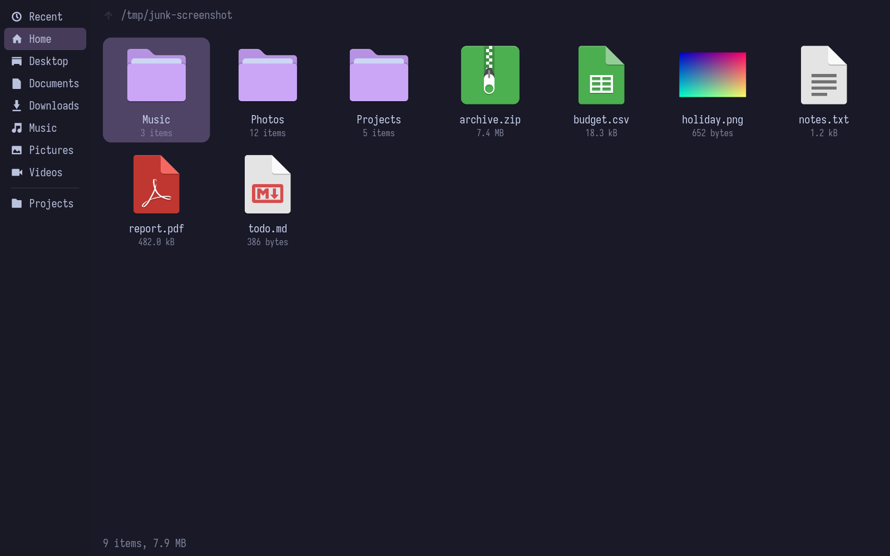
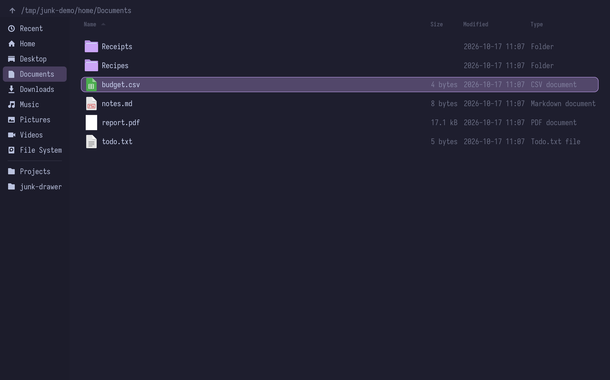
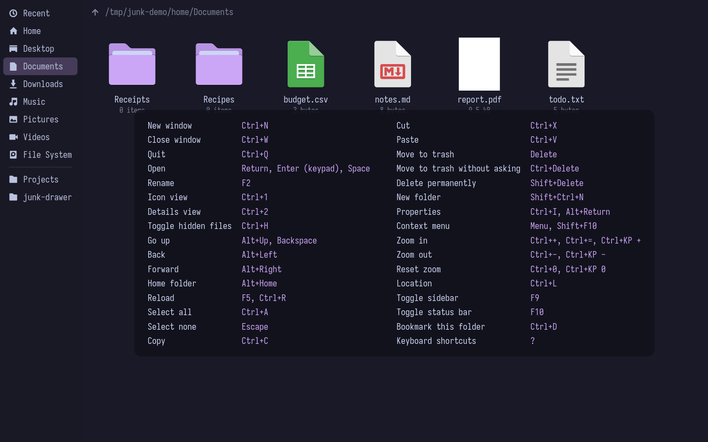
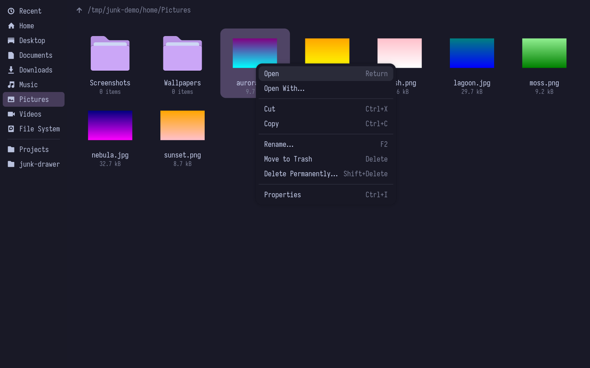
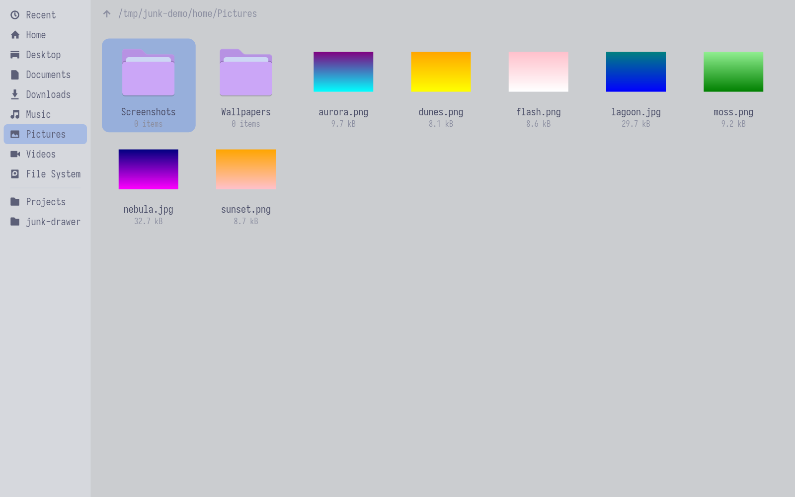

<p align="center">
  
</p>

<h1 align="center">Junk Drawer</h1>

<p align="center">A small GTK 4 file manager for Hyprland, in Catppuccin colours.</p>

> [!WARNING]
> **Certified, artisanal, vibe-coded slop.**
>
> No human has read this code. An AI wrote all of it while a person said "yeah, looks
> good" and pressed Enter a lot. It has strong opinions about Catppuccin and only mild ones
> about your data, and it really does copy, move and delete files. If you're fond of yours,
> use a file manager made by people who know what they're doing.
>
> Like any good junk drawer, things get tossed in, nothing gets organised, and the scissors
> turn up eventually. Bug reports will be read with great affection and then ignored.



Junk Drawer (`junk`) is a minimal file manager for tiling Wayland setups. It has no
toolbar or libadwaita, only an optional status bar (<kbd>F10</kbd>), and every action can be bound to keys of your choice.

## Features

- **Two views:** an icon grid with thumbnails, and a details list with Size, Modified
  and Type columns. Sort by any column, with names sorted naturally (`file2` before `file10`).
- **Sidebar:** Recent, Home, your XDG folders, bookmarks (shared with Nautilus and the
  GTK file chooser), and removable drives you can mount, unmount and eject.
- **File operations:** copy, move, drag and drop between apps, cut and paste
  that works with Nautilus and Thunar, trash, and a name-clash dialog (Replace, Merge,
  Skip, Rename) with a progress window for long transfers.
- **Catppuccin theming:** all four flavors and all 14 accents, a transparent window
  background, or `flavor = gtk` to follow your GTK theme (Stylix included).
- **Keyboard first:** every binding can be changed in `keybindings.ini`; press <kbd>?</kbd> to see them all.
- **Freedesktop integration:** thumbnails shared with other apps, the XDG trash,
  `org.freedesktop.FileManager1` for "Show in folder" in browsers, and the default
  apps from `mimeapps.list`.

| | |
|---|---|
|  |  |
|  |  |

## Install

Still here? Bold. Scroll up, reread the warning, then carry on.

### Nix

Try it without installing:

```sh
nix run github:DisposableSoftware/junk-drawer
```

As a flake input, with the NixOS module:

```nix
{
  inputs.junk-drawer.url = "github:DisposableSoftware/junk-drawer";

  # in your NixOS configuration
  imports = [ inputs.junk-drawer.nixosModules.default ];
  programs.junk-drawer = {
    enable = true;
    defaultFileManager = true; # open folders with Junk Drawer
  };
}
```

The NixOS module also turns on `services.gvfs` (trash, Recent, network locations)
and `services.udisks2` (removable drives).

Or with home-manager, which can also write your settings:

```nix
{
  imports = [ inputs.junk-drawer.homeManagerModules.default ];
  programs.junk-drawer = {
    enable = true;
    defaultFileManager = true;
    settings = {
      appearance = { flavor = "mocha"; accent = "mauve"; opacity = 0.85; };
      view.default = "icons";
    };
    keybindings.go-up = [ "<Alt>Up" "BackSpace" ];
  };
}
```

With either module, `fileManager1` (on whenever `defaultFileManager` is) lets D-Bus start
Junk Drawer for "Show in folder" requests when it isn't running. There is also an overlay,
`overlays.default`, which adds `pkgs.junk-drawer`.

### From source

You need Rust 1.92 or newer, GTK 4.20 or newer, and `pkg-config`. The install script
builds a release and puts the binary, desktop entry, icons, AppStream metainfo and man
page where launchers and `man` look:

```sh
scripts/install.sh                          # into ~/.local
sudo PREFIX=/usr/local scripts/install.sh   # for every user
scripts/install.sh --uninstall              # same PREFIX as the install
```

Packagers can stage with `DESTDIR`. Make sure `~/.local/bin` is on your `PATH` for a
user install.

For the trash, Recent and network locations, install `gvfs`; for removable drives,
`udisks2`. Thumbnails for videos, PDFs and other files come from any installed
thumbnailer, such as `ffmpegthumbnailer` or `evince`.

## Usage

```sh
junk                 # a window on your home folder
junk ~/Downloads /mnt sftp://host/srv   # one window for each path or URI
junk --help
man junk             # every binding, every setting, and how thumbnails work
```

Junk Drawer runs as a single instance, so new windows open in the running process.
Every window, dialogs included, has the Wayland app ID
`io.github.DisposableSoftware.JunkDrawer`, which you can match in Hyprland window rules.

### Mouse

Double-click opens an item, and right-click opens the context menu. The back and forward
thumb buttons navigate history, and <kbd>Ctrl</kbd>+scroll zooms. Drag files to move them
on the same filesystem or copy them to another; hold <kbd>Ctrl</kbd> to copy or
<kbd>Shift</kbd> to move.

### Keyboard

These are the defaults. Press <kbd>?</kbd> in any window to see all of them, with your changes.

| Action | Keys |
|---|---|
| Open | <kbd>Return</kbd>, <kbd>Space</kbd> |
| Go up / back / forward | <kbd>BackSpace</kbd>, <kbd>Alt</kbd>+<kbd>↑</kbd> / <kbd>Alt</kbd>+<kbd>←</kbd> / <kbd>Alt</kbd>+<kbd>→</kbd> |
| Home folder | <kbd>Alt</kbd>+<kbd>Home</kbd> |
| Type a location (Tab completes) | <kbd>Ctrl</kbd>+<kbd>L</kbd> |
| Icon / details view | <kbd>Ctrl</kbd>+<kbd>1</kbd> / <kbd>Ctrl</kbd>+<kbd>2</kbd> |
| Show hidden files | <kbd>Ctrl</kbd>+<kbd>H</kbd> |
| Toggle the sidebar | <kbd>F9</kbd> |
| Bookmark this folder | <kbd>Ctrl</kbd>+<kbd>D</kbd> |
| Copy / cut / paste | <kbd>Ctrl</kbd>+<kbd>C</kbd> / <kbd>Ctrl</kbd>+<kbd>X</kbd> / <kbd>Ctrl</kbd>+<kbd>V</kbd> |
| Rename | <kbd>F2</kbd> |
| New folder | <kbd>Ctrl</kbd>+<kbd>Shift</kbd>+<kbd>N</kbd> |
| Move to trash / delete permanently | <kbd>Delete</kbd> / <kbd>Shift</kbd>+<kbd>Delete</kbd> |
| Properties | <kbd>Ctrl</kbd>+<kbd>I</kbd> |
| Context menu | <kbd>Menu</kbd>, <kbd>Shift</kbd>+<kbd>F10</kbd> |
| Zoom in / out / reset | <kbd>Ctrl</kbd>+<kbd>+</kbd> / <kbd>Ctrl</kbd>+<kbd>-</kbd> / <kbd>Ctrl</kbd>+<kbd>0</kbd> |
| New window / close window | <kbd>Ctrl</kbd>+<kbd>N</kbd> / <kbd>Ctrl</kbd>+<kbd>W</kbd>, <kbd>Q</kbd> |

## Configuration

Settings live in `~/.config/junk-drawer/config.ini` and keybindings in
`~/.config/junk-drawer/keybindings.ini`. The first time Junk Drawer starts, it creates
whichever is missing, with every option listed at its default but commented out: remove
the `# ` from a line to change it. It never writes to a file that already exists, so
configs from dotfiles or home-manager are left alone. Changes apply when Junk Drawer
restarts. The same lists are in [`data/config.example.ini`](data/config.example.ini) and
[`data/keybindings.example.ini`](data/keybindings.example.ini).

Junk Drawer also remembers what you change while using it: the view, the sort, hidden
files, the sidebar and the zoom. It keeps them in `~/.local/state/junk-drawer/state.ini`,
and they win over the matching `[view]` settings, which then only apply until you change
something. Delete that file to go back to your `config.ini` values, or set
`remember = false` under `[view]` to always start from them.

```ini
[appearance]
# latte, frappe, macchiato or mocha, or gtk to use your GTK theme's colours
flavor = mocha
accent = mauve
opacity = 0.85

[view]
default = icons
show-sidebar = true
show-thumbnails = true
```

```ini
# keybindings.ini: GTK accelerator syntax; separate keys with ';', leave empty to unbind
[keybindings]
go-up = <Alt>Up;BackSpace;<Ctrl>u
trash =
```

For extra styling, put GTK CSS in `~/.config/junk-drawer/style.css`. The palette's colour
names (`@base`, `@mauve`, `@accent`, …) are available there, and Junk Drawer's own rules
are all under `window.junk`:

```css
window.junk .sidebar { background: alpha(@crust, 0.6); }
```

## Development

What Junk Drawer does is written down in [`spec/`](spec/README.md): every behaviour is
a numbered requirement, and the code follows it. `cargo test` checks the keybinding and
settings tables in the spec against the code, the example config and the man page.

```sh
nix develop                 # cargo, clippy, rustfmt, rust-analyzer, GTK 4
cargo run
cargo clippy --all-targets -- -D warnings
cargo test
nix build                   # ./result/bin/junk
```

The scripts in [`scripts/manual/`](scripts/manual) drive the app on Hyprland to check
what unit tests can't, such as focus, menus and screenshots.

To launch the dev build from your launcher without installing it, run
`scripts/sync-desktop.sh` after `nix build`: it copies the desktop entry (pointing at
`./result/bin/junk`) and the icons into `~/.local/share`, only when they changed.
`--remove` takes them out again.

## Credits

The colours are [Catppuccin](https://catppuccin.com), a community-driven pastel theme by the [Catppuccin organisation](https://github.com/catppuccin/catppuccin) and its contributors. The palette is theirs, not ours, and is MIT-licensed. The files in `data/themes/` carry the values from the [official palette](https://catppuccin.com/palette).

## License

MIT, see [LICENSE](LICENSE).
